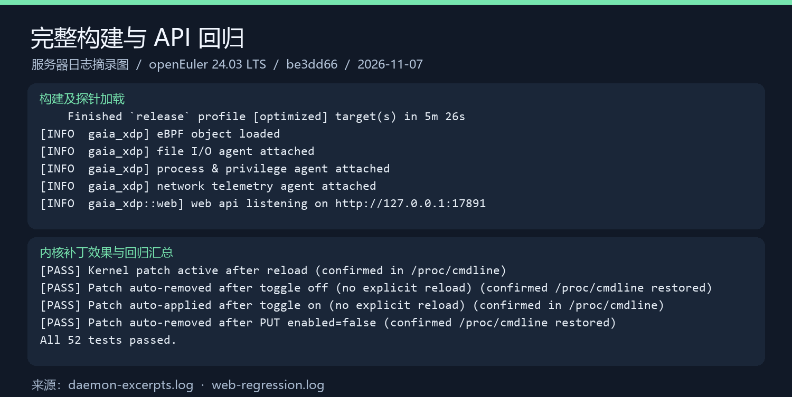
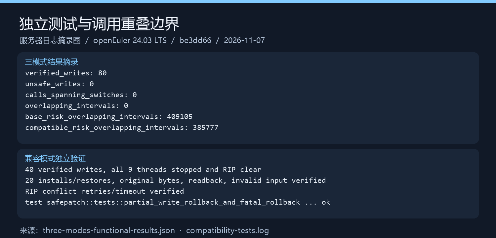
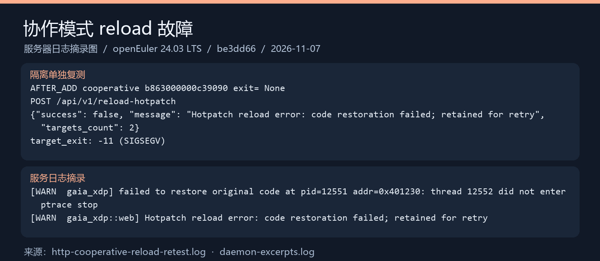

# 任务四② 测试证据：be3dd66 功能测试与边界分析

本目录保存任务四②在提交 `be3dd66` 上的测试证据。测试结论和分析见[功能测试与边界分析报告](../../functional-test-report.md)。

| 项目 | 内容 |
| --- | --- |
| 被测提交 | `be3dd66ecc1aa4479a490df8cfb8caefa9c2c836` |
| 原版对照 | `eec1660a4d6679fb3ce687b757a25578a6abd326`（本地 `base` 分支） |
| 测试日期 | 2026-11-07（日本时间） |
| 测试环境 | 华为云 ECS，openEuler 24.03 LTS（非 SP4），x86_64，内核 `6.6.0-112.0.0.104.oe2403.x86_64`，cgroup v2 |
| 隔离方式 | Gaia 使用独立配置和数据库，只监听本机回环地址（首轮 `127.0.0.1:17891`，补测 `127.0.0.1:17892`）；测试期间未修改项目源码 |

## 1. 文件清单

本目录保留首轮证据与后续补测，不覆盖原始失败结果。首轮包括 8 个日志/结果文件（含补充的 T5 摘要）和 3 张图；后续新增 8 个证据及校验文件，连同本说明共 20 个文件。

### 1.1 日志与结果文件

| 文件 | 内容 | 对应测试 | 结果 |
| --- | --- | --- | --- |
| [daemon-excerpts.log](daemon-excerpts.log) | release 构建结果、探针加载日志、reload 失败时的守护进程警告 | T1、T2、T12 | 构建通过；reload 失败 |
| [startup.json](startup.json) | 守护进程启动后的功能开关、事件计数和 systemd 服务状态 | T2 | ✅ 已通过 |
| [web-regression.log](web-regression.log) | 仓库原有 `tests/test_web_api.sh` 的逐项输出 | T3 | ✅ 52/52 已通过 |
| [three-modes-functional-results.json](three-modes-functional-results.json) | 三模式独立套件的功能与边界字段（安装、恢复、校验写入、重叠计数） | T4～T7 | ✅ 已通过 |
| [cooperative-timeout.log](cooperative-timeout.log) | 首轮 long_running.summary 原样复制，含 TIMEOUT verified；修补原先 T5 引用 JSON 缺少超时字段的问题 | T5 | ✅ 已通过 |
| [compatibility-tests.log](compatibility-tests.log) | 兼容模式独立套件和故障注入单元测试的输出 | T8、T9 | ✅ 已通过 |
| [http-patch-three-paths.log](http-patch-three-paths.log) | HTTP 三条路径：协作模式缺少 ABI、兼容模式、协作模式 reload | T10～T12 | T10 ✅；T11 ⚠️；T12 ❌ |
| [http-cooperative-reload-retest.log](http-cooperative-reload-retest.log) | 协作模式 reload 的隔离单独复测，含目标退出码 | T12 | ❌ 目标以 SIGSEGV 退出 |
| README.md | 本说明 | — | — |

### 1.2 结果图

以下 3 张图是**根据上述日志排版生成的摘录图**，不是终端原始截图。数据来自对应日志，文字包含标题、重排字段和解释，可用于汇报材料；判断结果请以日志文件为准。

| 图 | 内容 | 来源日志 |
| --- | --- | --- |
| [01-构建与API回归.png](01-构建与API回归.png) | release 构建、探针加载、内核补丁生效与撤销、52 项回归汇总 | `daemon-excerpts.log`、`web-regression.log` |
| [02-三模式与兼容测试.png](02-三模式与兼容测试.png) | 三模式独立套件结果、兼容模式验证 | `three-modes-functional-results.json`、`compatibility-tests.log` |
| [03-协作模式reload故障.png](03-协作模式reload故障.png) | reload 接口返回、目标退出码、守护进程警告 | `http-cooperative-reload-retest.log`、`daemon-excerpts.log` |







### 1.3 文件处理说明

- 日志去除了 ANSI 颜色代码，临时目录统一替换为 `<TEST_DIR>`，其余内容未改动。
- `three-modes-functional-results.json` 从原始 `results.json` 中摘取功能与边界字段；性能字段不在本目录，性能数据由任务四①维护。
- `daemon-excerpts.log` 是守护进程日志的摘录。完整原始日志、源码 bundle 和证据压缩包保存在测试者本地，没有提交。

### 1.4 补测证据（P1～P9）

| 文件 | 内容 |
| --- | --- |
| [supplemental-results.json](supplemental-results.json) | 13 类 HTTP 场景各 10 轮、10 轮时间戳复核和 1 组监控断言；包含旧采样异常 |
| [supplemental-http.jsonl](supplemental-http.jsonl) | 每一步修改请求、HTTP 状态、响应和单调时钟记录 |
| [supplemental-monitor.json](supplemental-monitor.json) | 仅保留专用测试 PID 的事件、告警、合成路径配置和操作返回码 |
| [supplemental-core.log](supplemental-core.log) | 原高频目标崩溃后的 GDB 分析输出，不是在线调试 |
| [supplemental-probes.json](supplemental-probes.json) | reload 前后的 bpftool 输出、新增链接及工具可见性限制 |
| [supplemental-daemon.log](supplemental-daemon.log) | 崩溃、拒绝写入、多目标部分失败、旧采样异常等代表轮次的守护进程日志 |
| [supplemental-environment.json](supplemental-environment.json) | 同一 release 哈希、环境、每批脚本快照哈希、core 哈希与清理检查 |
| [supplemental-SHA256SUMS](supplemental-SHA256SUMS) | 上述 7 个补测证据文件的 SHA256 |

补测证据由 [summarize.py](../../../tests/functional/summarize.py) 从原始目录生成。日志只将本次服务器测试根路径替换为 `<TEST_ROOT>`、源码路径替换为 `<SOURCE>`；监控快照按测试 PID 筛选，完整快照仍在本地原始包。所有取回文件按服务器清单逐项校验通过。预跑与正式批次分开，预跑不计入统计。正式统计为 13 类 HTTP 场景各 10 轮共 130 轮，另加 10 轮时间戳复核，合计 140 轮。

`matched=true` 表示符合用例预期；`reload-original` 的预期是复现崩溃，**不能把 matched 数量当成功能通过数**。首批 110 轮、后续 20 轮使用驱动接收时间，另 10 轮使用目标内部调用完成时间。旧的单次混入不被删除，也不被直接认定为已证明的调用时序错误。

## 2. 结果概览

| 状态 | 测试 |
| --- | --- |
| ✅ 已通过 | T1 构建、T2 启动、T3 API 回归、T4～T7 三模式独立套件、T8～T9 兼容模式、T10 缺少 ABI 时拒绝 |
| ⚠️ 有异常 | T11 兼容模式 HTTP：接口成功，但恢复后入口残留 uprobe 断点 `0xCC` |
| ❌ 失败 | T12 协作模式 HTTP reload：目标进程崩溃 |
| ✅ 补测已执行 | 内置路径告警、exec、两级权限变更调用告警、IPv4 端口拦截；真实返回值、skip_call、PUT/DELETE、replace_function 拒绝、带符号 PIE、多目标边界、13 类各 10 轮 |
| ❌ 补测确认的缺陷 | 原高频目标 reload 10/10 崩溃；自定义敏感路径访问可见却无敏感文件告警 |
| ⚠️ 保留的边界 | 多目标非事务、删除后探针断点残留、旧采样一轮混入；按目标时间戳定向复核 10/10 通过 |
| ⏳ 待补测 | 任务三修复后的回归、IPv6、setgid、线程变化/退出、剥离符号、WebUI 手工交互与长时压力 |

T3 的 52 项主要覆盖内核 livepatch 配置接口，不是全部接口的回归。待补测项的说明见[报告第 5 节](../../functional-test-report.md#5-测试完整度评估)。

## 3. 复现方法

### 3.1 独立套件

在 Linux x86_64 上检出被测提交，确认本地 `base` 指向 `eec1660a4d6679fb3ce687b757a25578a6abd326`，脚本会从该分支提取原版写入器做对照。需要 C 编译器、Rust/Cargo、Python 3、Git，以及追踪测试子进程的权限。

```bash
CARGO_NET_OFFLINE=true bash tests/safepatch/run.sh /tmp/gaia-safepatch-three-modes
```

```bash
bash tests/safepatch/run-compat.sh /tmp/gaia-safepatch-compatible
```

`CARGO_NET_OFFLINE=true` 依赖已有的 Cargo 缓存。本次首次在线运行时服务器无法解析 `index.crates.io`，离线重跑后通过，证据只采用重跑结果。

### 3.2 守护进程与 API 回归

```bash
cargo build --release --locked -p gaia-xdp -j 1
```

使用独立配置和数据库启动隔离实例后执行：

```bash
bash tests/test_web_api.sh http://127.0.0.1:17891
```

回归脚本会实际加载并撤销内核测试补丁，应在专用测试机上执行。

### 3.3 协作模式 HTTP reload 故障

1. 运行 `tests/safepatch/high_frequency.c` 编译的协作目标，记录 READY 输出中的 PID 和函数入口。
2. 向 `POST /api/v1/config/hotpatch` 提交目标的二进制路径和 PID，参数为 `symbol=target_value`、`enabled=true`、`patch_action=override_return`、`override_return_value=99`、`patch_mode=cooperative`。
3. 确认目标存活且入口已改写为 `b863000000c39090`，再调用 `POST /api/v1/reload-hotpatch`。
4. 观察到的结果：接口返回 `success=false` 和 `code restoration failed; retained for retry`，目标以 -11（SIGSEGV）退出，守护进程记录 `thread ... did not enter ptrace stop`。

对崩溃原因的分析见[报告第 4 节](../../functional-test-report.md#4-协作模式-reload-崩溃现象与根因分析)。首轮时属于推断；后续 core 与 monitor 对照已支持该用例的断点覆盖及错位执行机制，**尚未修复，也不能推广为所有 reload 故障的唯一原因**。

修复后的验收标准：目标进程在 reload 前后持续存活；reload 返回成功；补丁期间函数实际返回 99；删除补丁后入口恢复为原始字节。若观察到 `0xCC`，应分别记录 uprobe 断点和补丁字节。

## 4. 适用范围

- 协作模式的独立测试结果只适用于本次目标程序和测试窗口。
- 兼容模式确认了线程暂停和覆盖区间 RIP 检查，但长调用实验中仍存在新旧调用重叠，这符合它“不保证排空”的设计。
- HTTP reload 崩溃必须和独立套件通过分开记录，不能用后者代替前者。

补测复现入口：[tests/functional/README.md](../../../tests/functional/README.md)。本目录不包含 core、数据库、编译产物、SSH 配置、密钥或原始压缩包。
