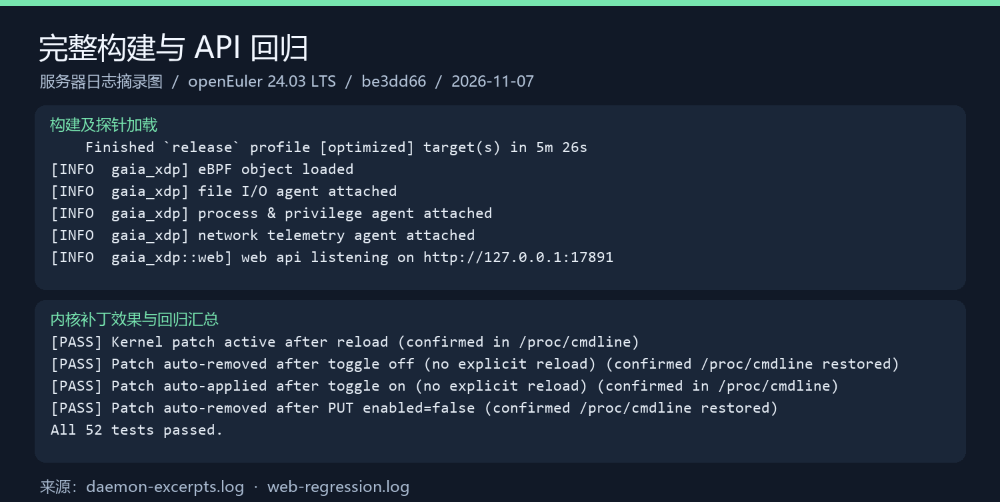
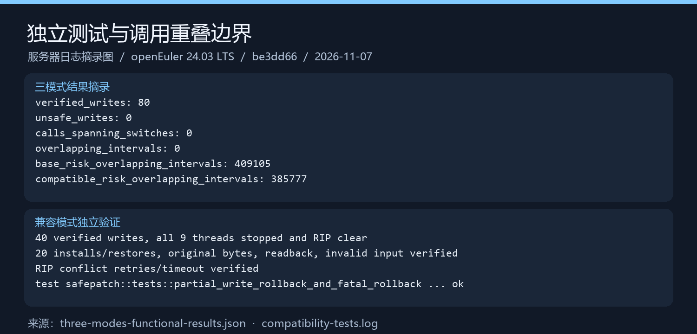
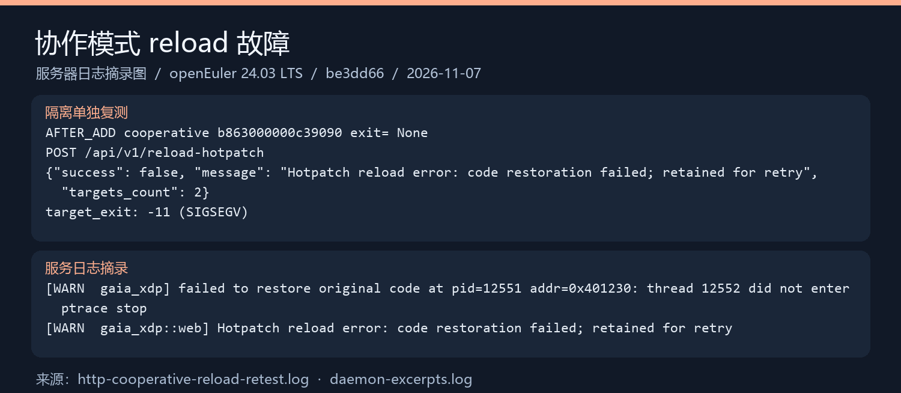

# 任务四②：功能测试与边界分析报告

| 项目 | 内容 |
|---|---|
| 被测提交 | `be3dd66ecc1aa4479a490df8cfb8caefa9c2c836`（`main`，含协作与兼容两种 SafePatch） |
| 原版对照 | `eec1660a4d6679fb3ce687b757a25578a6abd326`（`base`） |
| 测试日期 | 2026-11-07 |
| 测试环境 | 华为云 ECS，openEuler 24.03 LTS（非 SP4），x86_64，内核 `6.6.0-112.0.0.104.oe2403.x86_64`，cgroup v2 |
| 原始证据 | [docs/evidence/be3dd66-functional/](evidence/be3dd66-functional/README.md) |

本报告只记录本轮实际执行过的测试。复现步骤见[证据目录说明](evidence/be3dd66-functional/README.md)，测试脚本的设计见[运行测试与解读结果](safepatch-testing.md)。

状态标记：✅ 已通过　⚠️ 有异常　❌ 失败　⏳ 待补测

## 1. 结论

1. **独立安全测试全部通过。** 协作模式 40 次安装、40 次恢复、80 次写入读回校验，观测到的新旧调用重叠为 0。兼容模式 40 次写入校验通过，冲突超时和故障注入回滚通过。
2. **原有 Web API 回归 52 项全部通过**，其中包括内核 livepatch 的实际生效与撤销。
3. **经过 HTTP 的用户态补丁路径存在严重缺陷。** 首轮两次复现后，补测中原高频目标又连续 10/10 次以 SIGSEGV（-11）退出，reload 返回 `success=false`；只挂 monitor 的对照 10/10 次存活。
4. **该用例的断点覆盖与错位执行机制已得到 core 和对照支持。** core 中 RIP 为 `target_value+1`，入口为 `cc 63 00 00 00 c3 90 90`，故障指令访问的地址与 RAX 一致（第 4.5 节）。这不代表所有 reload 故障都有相同原因，也不代表已修复。
5. **监控回归已执行，发现自定义敏感路径漏报。** 内置敏感路径、白名单外 exec、普通/服务权限变更告警、IPv4 端口拦截通过；配置的自定义路径有访问事件却没有敏感文件告警。
6. 补测覆盖 13 类 HTTP 场景，各 10 次，共 130 轮，另做 10 轮带目标时间戳的定向复核。旧采样有一轮收到旧返回值，保留该异常；修正分窗后 10/10 轮通过，不能据此抹去原记录。任务三修复后的复测仍待进行。

因此，验收时要把“独立测试通过”和“HTTP reload 失败”分开记录，不能用前者代替后者。

## 2. 测试分层

| 层次 | 测什么 | 是否启动 Gaia 守护进程 | 是否加载 eBPF |
|---|---|---|---|
| L1 构建 | release 构建（含 eBPF 字节码和 WebUI） | 否 | 否 |
| L2 独立安全套件 | 直接调用 `safepatch.rs` 写入器，对真实 C 进程做暂停、写入、恢复 | 否 | 否 |
| L3 守护进程启动 | 探针加载、Web 服务、服务识别 | 是 | 是 |
| L4 Web API 回归 | 仓库原有 `tests/test_web_api.sh` | 是 | 是 |
| L5 HTTP 补丁集成 | 通过 HTTP 添加补丁和 reload，经过探针挂载、策略持久化和恢复 | 是 | 是 |

L2 证明写入器本身的安全逻辑，L5 证明它接入 Gaia 之后的整条链路。两者覆盖的代码路径不同。

## 3. 测试结果

### 3.1 已执行的测试

| 编号 | 测试 | 结果 | 证据 |
|---|---|---|---|
| T1 | release 构建 | ✅ 通过，耗时 5 分 26 秒 | [daemon-excerpts.log](evidence/be3dd66-functional/daemon-excerpts.log) |
| T2 | 守护进程启动：文件、进程、网络、热补丁探针加载 | ✅ 通过，六项 feature 均为 `true`，`sshd.service` 识别为运行中 | [startup.json](evidence/be3dd66-functional/startup.json) |
| T3 | Web API 回归 | ✅ 52/52 通过 | [web-regression.log](evidence/be3dd66-functional/web-regression.log) |
| T4 | 协作模式：高频调用与长调用，各 20 次安装和恢复 | ✅ 80 次写入校验，跨切换调用 0，新旧重叠 0，恢复失败 0 | [three-modes-functional-results.json](evidence/be3dd66-functional/three-modes-functional-results.json) |
| T5 | 协作模式：长调用排空超时 | ✅ 零超时切换按预期被拒绝 | [原始长调用摘要](evidence/be3dd66-functional/cooperative-timeout.log) |
| T6 | 原版写入器受控风险实验 | ✅ 复现新旧重叠，409105 次 | [three-modes-functional-results.json](evidence/be3dd66-functional/three-modes-functional-results.json) |
| T7 | 兼容模式受控风险实验 | ✅ 复现新旧重叠，385777 次（证明兼容模式**不保证**排空） | 同上（T6） |
| T8 | 兼容模式独立套件：20 次安装和恢复、无效输入、RIP 冲突超时 | ✅ 40 次写入校验，均为 9 线程停止且 RIP 无冲突 | [compatibility-tests.log](evidence/be3dd66-functional/compatibility-tests.log) |
| T9 | 兼容模式故障注入：部分写入失败回滚、回滚失败终止目标 | ✅ 单元测试通过 | 同上 |
| T10 | HTTP：协作模式，目标缺少 ABI | ✅ 按预期拒绝写入，目标存活 | [http-patch-three-paths.log](evidence/be3dd66-functional/http-patch-three-paths.log) |
| T11 | HTTP：兼容模式写入与恢复 | ⚠️ 接口成功，但恢复后入口第一个字节是 `0xCC` | 同上 |
| T12 | HTTP：协作模式添加补丁后 reload | ❌ 目标崩溃（SIGSEGV），接口返回 `success=false` | 同上、[http-cooperative-reload-retest.log](evidence/be3dd66-functional/http-cooperative-reload-retest.log) |

说明：

- T4～T7 的独立套件首次运行时，服务器无法解析 `index.crates.io`，构建失败（退出码 101）。改用已有 Cargo 缓存离线重跑后通过。证据只采用离线重跑的结果。
- T3 的 52 项主要覆盖内核 livepatch 配置接口，另有 5 项检查 `/state`、`/config`、`/config/hotpatch` 等原有接口仍然可用。它**不是**所有接口的完整回归。
- T4 和 T6、T7 中的重叠计数统计的是“遇到另一版本活动区间的调用数”，不是线程数，也不是性能指标。

### 3.2 补测结果（2026-11-07，openEuler ECS）

以下是 T1～T12 之后独立执行的补测，使用同一个干净提交和 release 程序。逐轮证据见 [supplemental-results.json](evidence/be3dd66-functional/supplemental-results.json)，脚本见 [tests/functional](../tests/functional/README.md)。不重新运行第一轮的内核 livepatch 套件，不把旧的 52 项累计成新通过次数。

| 编号 | 测试 | 状态 |
|---|---|---|
| P1 | 监控与 API 事件记录：1 组、11 个功能断言 | ⚠️ 10/11；自定义敏感路径漏报，另有清理后 bind 对照通过 |
| P2 | 原高频目标 reload、monitor 对照、core 分析 | ❌ 功能仍失败；崩溃 10/10，对照存活 10/10；该用例机制已确认 |
| P3 | 两模式实际返回值与 reload 后返回值 | ✅ 添加后 99、删除后 10；reload 后返回 99 **仅在五字节首指令的测试目标上成立**，原高频目标见 P2；采样边界见下文 |
| P4 | `skip_call`，显式返回值 0 | ✅ 10/10 返回 0，删除后 10 |
| P5 | `PUT` 修改、`DELETE` 删除 | ✅ 10/10：99 → 77 → 10；删除后可见探针断点，不能称入口字节完全复原 |
| P6 | 两模式 `replace_function` 写入拒绝 | ✅ 各 10/10；reload=false，目标返回 10；POST 仍接收配置，不等于 HTTP 请求被拒绝 |
| P7 | 一个有效目标和一个缺 ABI 的目标 | ⚠️ 10/10 确认非事务：reload=false，有效目标仍返回 99，另一目标返回 10 |
| P8 | 带符号的 PIE 目标 | ✅ 10/10：地址可解析，99 → 10；未覆盖剥离符号 |
| P9 | 每类 HTTP 场景重复测试 | ✅ 修复前 13 类各 10 次已执行；另有 10 次采样复核；修复后复测仍依赖任务三 |

**采样边界必须保留。** 第一批 110 轮和第二批 20 轮按驱动收到 stdout 的时间分窗。第二批协作 reload 第 3 轮，接口成功、目标存活、入口补丁正确，但窗口中有 1 个旧值 10 和 564 个新值 99，因此严格断言为 false。不能确认旧调用发生在 HTTP 返回之后，因为日志可能滞留在管道或打印前。随后只修改测试目标，给调用记录增加目标内部 CLOCK_MONOTONIC 开始/完成时间，定向复核协作 reload 10/10 通过。旧异常保留，结论限于采样窗口，不声称消除了所有瞬态旧值。

这个旧值在代码层面有合理解释，但**没有单独验证**：`api_reload_hotpatch` 先恢复全部原始代码，再重新写入补丁，两次切换各自开关一次门禁。两次切换之间，函数会短暂执行原始代码并返回 10。也就是说，**reload 不是原地切换，期间补丁会短暂失效**，这是使用 reload 时需要知道的语义边界。

**监控缺陷。** 测试在 `/var/lib/gaia` 下创建合成文件，内置路径告警正常；另在独立测试目录创建文件并加入 `sensitive_prefixes`，文件打开成功且同 PID 的访问事件可见，却没有 high 告警。代码中 eBPF 的 `SENSITIVE_PATHS` 写死四类路径，用户态又要求 `EVENT_ACTION_ALERT` 才生成敏感文件告警，配置新增路径不能触发该前置标记。权限测试用 `setuid(getuid())` 验证调用告警，不代表发生了成功提权；普通进程 high、服务 high/critical 均已按 PID 确认。网络只测了 IPv4 bind/connect 和对应告警。

### 3.3 结果图

以下图片对应首轮 T1～T12，根据证据日志排版生成，不是终端原始截图；不包含之后的补测结果，判断结果以日志为准。







## 4. 协作模式 reload 崩溃：现象与根因分析

> **状态：首轮推断已在本次同环境补测中获得 core 和 monitor 对照支持，详见第 4.5 节。故障尚未修复。** 第 4.1～4.3 节保留首轮现象及推断过程，不能将其泛化为所有目标都必然崩溃。

### 4.1 现象

目标程序为 `tests/safepatch/high_frequency.c` 编译的协作目标，函数 `target_value` 原本返回 10。

| 步骤 | 函数入口 8 字节 | 目标进程 |
|---|---|---|
| 添加补丁前 | `55 48 89 e5 b8 0a 00 00`（`push rbp; mov rbp,rsp; mov eax,10 ...`） | 存活 |
| `POST /api/v1/config/hotpatch` 之后 | `b8 63 00 00 00 c3 90 90`（`mov eax,99; ret; nop; nop`） | 存活 |
| `POST /api/v1/reload-hotpatch` 之后 | 无法读取 | **退出，信号 SIGSEGV** |

守护进程日志同时记录了 `thread 12552 did not enter ptrace stop`，接口返回 `code restoration failed; retained for retry`。

### 4.2 首轮推断与机制说明

对照代码，添加补丁（[web.rs](../gaia-xdp/src/web.rs) 中的 `api_add_hotpatch`）和 reload（`api_reload_hotpatch`）都会**先调用 `attach_hotpatch_targets` 挂 uprobe，再恢复或写入机器码**。而 `attach_hotpatch_targets`（[main.rs](../gaia-xdp/src/main.rs)）每次都会新建 uprobe，没有检查是否已经挂过，也不会卸载旧的。

Linux 的 uprobe 有两个特点：

1. 挂载时，内核把函数入口第一个字节改成断点指令 `0xCC`。
2. 内核保存的“原始指令”是从**磁盘上的可执行文件**读的，不是从进程内存读的。线程碰到断点后，内核在别处执行这条原始指令，再跳回入口后面继续执行。

于是 reload 时发生了这样的事：

```text
内存中的入口（补丁已生效）：b8 63 00 00 00 c3 90 90
reload 再次挂 uprobe，第一个字节变成断点：cc 63 00 00 00 c3 90 90
内核保存的原始指令（来自磁盘文件）：55          ← push rbp，1 字节

工作线程调用 target_value：
  碰到 0xCC → 内核执行 push rbp → 跳回“入口 + 1 字节”继续执行
  入口 + 1 处是 63 00 ...，CPU 把它解码成 movsxd eax, [rax]
  rax 不是有效地址 → SIGSEGV
```

恢复阶段的 `did not enter ptrace stop` 与目标崩溃同时出现；这条警告单独不足以定位根因，需结合第 4.5 节的 core。

### 4.3 旁证

同一个机制也能解释另外两条 HTTP 记录：

- **T10（缺少 ABI）**：uprobe 挂上后入口变成 `cc 0a 00 00 00 ...`，补丁被拒绝，没有写入，所以入口一直是断点加原始字节，目标存活。
- **T11（兼容模式）**：添加补丁时先挂 uprobe，入口变成 `cc 0a 00 00 00 ...`；写入器随后把这 8 个字节当作“原始字节”保存，再用补丁覆盖，断点也被一起覆盖掉了。恢复时写回的是带 `0xCC` 的字节，所以恢复后读到 `cc 0a 00 00 00 c3 90 90`。兼容目标在磁盘上的原始指令恰好是 5 字节的 `mov eax,10`，碰到断点后内核执行 `mov eax,10`，再跳到入口 + 5 处的 `ret`，所以**侥幸没有崩溃**。不过在 reload 重新挂 uprobe、到再次写入补丁之间的短暂窗口里，调用会返回旧值 10。

这说明问题不只出在协作模式：**只要磁盘上的第一条原始指令和补丁字节的长度对不上，任何模式经过 HTTP reload 都可能崩溃。**此外，补丁覆盖了内核登记过的断点，内核记录的 uprobe 状态和实际内存已经不一致；之后卸载这个 uprobe 时会发生什么，本轮没有测试。

### 4.4 验证方法与修复方向

以下方法用于补测，不需要修改 Gaia 代码；实际结果及工具限制见第 4.5 节：

1. **读入口字节**：在添加补丁前、添加补丁后、reload 后、删除补丁后，分别从 `/proc/<pid>/mem` 读取函数入口 8 字节，检查是否出现 `0xCC`。
2. **记录探针挂载**：结合 `bpftool link show` 和 `bpftool perf show`，记录 Gaia 持有的程序、链接、目标文件和偏移，比较 reload 前后；不能只按输出中的 PID 认定目标进程。具体可见性取决于 Aya 的挂载方式、内核和 bpftool 版本。`uprobe_events` 中没有记录不能证明探针不存在。
3. **分析崩溃现场**：只给测试目标开启 core dump，事后用 GDB 读取实际 RIP、故障地址、寄存器、入口字节、栈和内存映射，不在线附加调试器。入口加 1、`63 00` 和保存的 RBP 都是待检验线索，不是预设结论；单个栈值不能独立证明执行过 `push rbp`。
4. **对照实验**：只挂 uprobe、不写机器码补丁（`patch_action = "monitor"`）时执行 reload，目标应保持存活。
5. **检查返回值**：补丁期间持续采样 `target_value()` 的返回值，确认是否为 99。

只有实际崩溃现场与对照实验共同支持因果链，才能确认该用例的崩溃机制；不能据此断言所有 reload 问题都有相同原因。证据不足时继续保留“推断”。

修复思路（供任务三负责的同学参考）：

- 对已经打了机器码补丁的函数，不再挂 uprobe；或者先卸载 uprobe，再写机器码。
- `attach_hotpatch_targets` 记录已挂载的链接，避免重复挂载，并在删除目标时卸载。
- 保存原始字节时，如果发现第一个字节是 `0xCC`，应先确认探针归属并拒绝不安全的覆盖；不能直接拿磁盘字节替换运行时字节，忽略重定位或其他合法修改。

修复后的验收标准：同一用例中目标在 reload 前后持续存活；reload 返回成功；补丁期间函数确实返回 99；删除补丁后入口恢复为 `55 48 89 e5 b8 0a 00 00`。还要复查 T10、T11 和 T3。

### 4.5 补测中的实际现场

- 原高频目标 `target_value=0x401230`，core 中 `RIP=0x401231`，故障指令为 `movsxd eax,DWORD PTR [rax]`。入口字节为 `cc 63 00 00 00 c3 90 90`，`si_addr=RAX=0x79c77d64af1`，信号为 SIGSEGV / SEGV_MAPERR。栈顶等于 RBP，是执行原始 `push rbp` 的辅助证据，不单独作为因果证明。
- 相同原高频目标只挂 monitor、不写补丁，reload 10/10 成功并存活；打补丁后的 reload 10/10 崩溃。
- bpftool 7.2 的 `link show` 在 reload 后增加两个 `perf_event` 链接（447、448），复用了原链接的程序 ID（582、583），与再次挂 entry/return 探针的日志相符。但本机 `perf show` 没有枚举 Gaia 的 uprobe，`link show` 也未给出目标路径，不能宣称已用该工具独立确认每个探针的位置。
- 因此该用例的“探针断点覆盖补丁首字节，随后从旧指令长度之后执行补丁残余字节”的机制有直接现场和对照支持。五字节首指令测试目标可存活，不能据此认为其探针与补丁共存是安全的。

证据：[GDB 现场](evidence/be3dd66-functional/supplemental-core.log)、[探针原始输出](evidence/be3dd66-functional/supplemental-probes.json)、[守护进程摘录](evidence/be3dd66-functional/supplemental-daemon.log)、[逐步 HTTP](evidence/be3dd66-functional/supplemental-http.jsonl)。core 二进制保留在服务器，未加入仓库。

## 5. 测试完整度评估

### 5.1 已覆盖

| 方面 | 覆盖情况 |
|---|---|
| 写入器安全逻辑 | 全线程暂停、线程集核对、读回校验、恢复、排空超时、无效输入、故障注入回滚 |
| 风险对照 | 原版和兼容模式都受控复现了新旧重叠 |
| 守护进程 | release 构建、eBPF 加载、启动状态 |
| 原有接口 | 内核 livepatch 配置接口全流程，以及几个基本接口 |
| HTTP 集成 | 首轮三条路径；补测 13 类场景各 10 轮，含实际返回值、skip_call、PUT/DELETE、replace_function 拒绝、多目标部分失败、带符号 PIE，另有 10 轮时间戳复核 |
| 监控功能 | 内置敏感路径、自定义敏感路径（发现漏报）、白名单外 exec、两级权限变更告警、IPv4 端口拦截及 API 事件记录 |

### 5.2 当前剩余缺口与待修复项

| 缺口 | 为什么重要 | 建议 |
|---|---|---|
| **reload 崩溃修复后的回归** | 已确认问题仍在，不能以“成功复现故障”代替功能通过 | 等任务三修复，按新提交复测 T10～T12、P2～P9，并回归 T3 |
| **自定义敏感路径漏报修复** | 配置接受但没有敏感文件告警 | 修复 eBPF/用户态路径判定后，复测内置、自定义和非敏感路径对照 |
| HTTP 切换瞬间语义 | 已采样实际返回值，但第一批分窗使用驱动接收时间，存在管道延迟边界 | 保留旧异常，后续使用目标内部时间戳，并扩大切换前后持续采样窗口 |
| 监控覆盖范围 | 本次确认 IPv4 bind/connect、setuid 调用和 API 中事件；不是完整监控验收 | 补 IPv6、setgid、失败权限调用及 WebUI 交互 |
| 目标进程在补丁过程中退出、线程数变化 | 属于固定线程模型的边界 | 至少各测一次，确认报错而非误报成功 |
| 剥离符号、内联及优化目标 | 带符号的 PIE 已通过，不能推广到其他形式 | 独立验证 stripped、优化及符号不可解析的拒绝路径 |
| WebUI 页面 | 只测了 API | 录演示视频时顺便做手工检查 |
| 长时稳定性 | 13 类 HTTP 场景已各 10 次，独立套件仍为首轮记录，非长期压力测试 | 修复后复测并增加运行时长；10 次不能证明极低故障率 |
| ARM64 | SafePatch 写入路径只实现了 x86_64 | 在文档中注明不支持，不需要测 |

### 5.3 总体评价

写入器和集成层均已有可复现证据，监控基础回归、真实返回值、PIE 与 HTTP 重复测试已补齐本轮约定范围。测试工作可以作为任务四②阶段性交付；**项目仍未达到最终验收**：reload 崩溃和自定义敏感路径漏报未修复，修复后的回归仍待进行。测试没有修改 Gaia Rust/eBPF 实现，也没有把负例复现计为功能成功。

### 5.4 环境与证据收尾

源码工作区仍干净，release SHA256 为 `5c495f59a9c7fb524672a1760f3777be1cff8f88ff6cf75c5c7d8ff0880fa754`。测试创建的 Gaia、目标和 transient service 已结束，17892 不再监听，封禁测试端口退出后可重新 bind，core_pattern 未改。为诊断安装了 gdb-headless、bpftool 及两个依赖，共下载约 4.6 MB，工具保留。core 和数据库保留在服务器测试目录；约 1.85 MB 的日志/脚本证据包已取回本地，逐文件 SHA256 核对通过。默认代理 SSH 配置保持原状，临时直连覆盖只用于本轮命令，已结束。环境与脚本快照信息见 [supplemental-environment.json](evidence/be3dd66-functional/supplemental-environment.json)。

## 6. 测试环境说明

小组的测试分布在两类环境中，引用数据时要注明来源：

| 环境 | 用途 |
|---|---|
| openEuler 24.03 LTS SP4 虚拟机（内核 `6.6.0-159.x.oe2403sp4`） | 任务一原版复现、任务二并发分析、`measured-results.json` 中的协作模式记录 |
| 华为云 ECS，openEuler 24.03 LTS（内核 `6.6.0-112.0.0.104.oe2403`） | 本报告的全部测试，以及任务四①的性能实验 |

两者都是 openEuler 24.03 LTS 系列的 6.6 内核，但小版本不同，结果不能直接混在一起比较。
