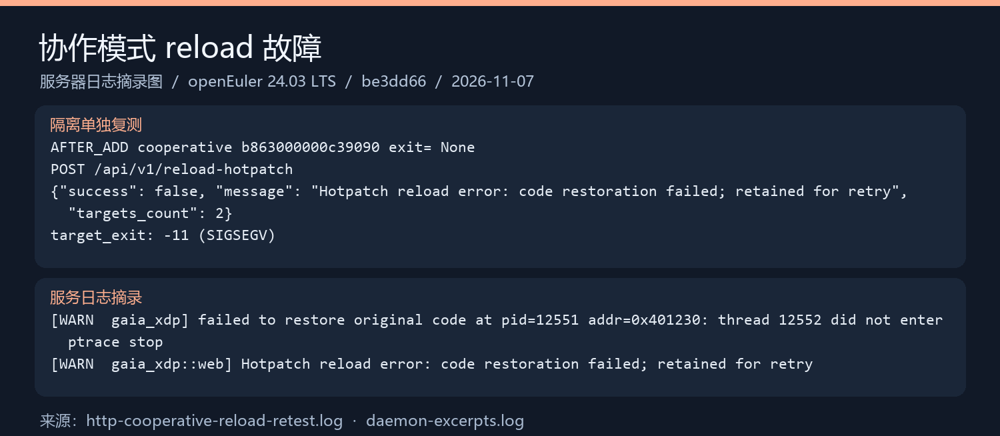

# Gaia-SafePatch 项目说明

| 项目 | 内容 |
|---|---|
| 选题 | 任务 3：利用 Rust 的内存安全和高性能特性，结合 openEuler 的 eBPF 支持，开发轻量级关键服务监控工具 |
| 基础项目 | Gaia（原作者 jask，2026 年 3～4 月开发），本组复现的基线提交为 `eec1660` |
| 本组主要提交 | `be3dd66`（`main`，含两种安全热补丁模式） |
| 运行平台 | openEuler 24.03 LTS，x86_64，内核 6.6，需开启 BTF 和 cgroup v2 |
| 文档日期 | 2026-11-07 |

**快速入口**

| 想看什么 | 去哪里 |
|---|---|
| 怎样编译和运行 | 本文第 4、5 节 |
| 任务四② 测试结论 | 本文第 6.2 节，完整内容见[功能测试与边界分析报告](functional-test-report.md) |
| 测试原始证据和结果图 | [证据目录](evidence/be3dd66-functional/README.md) |
| 已知问题 | 本文第 7 节 |
| SafePatch 原理 | [从零理解安全热补丁](safepatch-explained.md) |

本文中的测试状态统一使用：✅ 已通过　⚠️ 有异常　❌ 失败　⏳ 待补测。

## 1. 项目简介

### 1.1 要解决的问题

选题要求做到三件事：

1. **安全监控**：低开销地发现关键服务的异常行为，例如访问敏感文件、创建非法进程。
2. **热补丁**：对高危函数打补丁，不需要重启服务。
3. **发挥 openEuler 优势**：利用 openEuler 现代内核对 eBPF 的支持。

### 1.2 原项目 Gaia 已经做到的

Gaia 用 Rust 和 Aya 框架同时编写内核态的 eBPF 探针和用户态的守护进程，前三项需求都已有实现：

- **监控**：在 `openat`、`execve`、`setuid`/`setgid`、`connect`/`bind` 上挂探针，结合敏感路径、执行白名单和频率阈值产生告警。
- **拦截**：通过 cgroup 钩子直接拒绝指定端口的连接和监听。
- **热补丁**：用户态函数用 ptrace 改写入口机器码；内核函数生成并加载 livepatch 模块。
- **管理**：Web 控制台和 HTTP API，SQLite 保存历史事件，可选接入大模型分析告警。

### 1.3 本组的工作

复现 Gaia 时，任务二发现它的用户态热补丁**并发不安全**：

- 只暂停目标进程的一个线程，其他线程仍可能正在执行被修改的代码。
- 不等待正在执行的旧调用结束，同一个请求可能前半段用旧版本、后半段用新版本。

本组在 openEuler SP4 虚拟机上用 8 线程实验重复 30 轮，**240 个请求全部出现了新旧版本混用**。

围绕这个问题，本组实现了 **SafePatch**：

| 模式 | 适用对象 | 保证 |
|---|---|---|
| 协作模式 `cooperative`（默认） | 目标程序按约定导出门禁和活动调用计数 | 写入时全部线程已停止，并且旧调用已经排空，新旧调用不重叠 |
| 兼容模式 `compatible` | 无需修改的普通程序 | 写入时全部线程已停止，且没有线程正停在被覆盖的指令上；**不保证**排空旧调用 |

两种模式都会在写入后读回校验，写入失败时自动回滚到原始字节。

一句话概括：**Gaia 原项目提供了监控和热补丁能力，本组的贡献是发现并修复热补丁的并发安全问题，并做了系统的测试和性能评估。**

## 2. 系统架构

```text
┌──────────────────────────────────────────────────────────────┐
│ 用户交互：Web 控制台 / HTTP API（端口 17890）                  │
└───────────────────────────────┬──────────────────────────────┘
┌───────────────────────────────▼──────────────────────────────┐
│ 用户态守护进程 gaia-xdp（Rust + Tokio）                        │
│   事件采集 → 异常检测（白名单、频率基线）→ 告警 → SQLite        │
│   systemd 服务识别（每 5 秒读取服务的 cgroup）                 │
│   热补丁管理：符号解析 → SafePatch 协调器（safepatch.rs）      │
│   内核 livepatch 管理（livepatch.rs）                          │
└───────────────┬─────────────────────────────▲────────────────┘
       BPF map 下发策略               BPF ring buffer 上报事件
┌───────────────▼─────────────────────────────┴────────────────┐
│ 内核态 eBPF 探针（Rust + Aya）                                 │
│   tracepoint：openat / execve / setuid / setgid / connect / bind│
│   cgroup sock_addr：端口封禁                                  │
│   uprobe / uretprobe：热补丁目标函数的进入、返回观测            │
└──────────────────────────────────────────────────────────────┘
```

代码结构：

| 目录 | 内容 |
|---|---|
| `gaia-xdp-common/` | 内核态和用户态共用的数据结构，`no_std` |
| `gaia-xdp-ebpf/` | eBPF 探针 |
| `gaia-xdp/` | 守护进程。本组新增 `src/safepatch.rs`，并修改了 `main.rs`、`web.rs` |
| `gaia-webui/` | React 前端，编译后嵌入二进制 |
| `tests/safepatch/` | 本组的 SafePatch 测试套件 |

## 3. SafePatch 是怎样工作的

详细原理见[从零理解安全热补丁](safepatch-explained.md)，这里只列关键步骤。

### 3.1 协作模式

目标程序导出全局变量 `gaia_safepatch_state`，包含三个原子 64 位整数：`magic`（协议标识）、`gate`（入口门禁）、`active`（正在执行的调用数）。每次调用前先检查门禁并增加计数，调用结束后减少计数。

Gaia 打补丁的流程：

```text
1. 遍历 /proc/<pid>/task，用 PTRACE_SEIZE + INTERRUPT 停住全部线程，并逐个确认
2. 检查 magic，关闭门禁（gate = 1）
3. 如果 active > 0：放开线程，等约 2 ms 让旧调用完成，再停住全部线程重新检查
4. active == 0 后：保存原始字节 → 写入补丁 → 读回比对
5. 打开门禁，放开线程
```

排空最多等待 5 秒，超时则放弃写入并重新打开门禁。恢复原始代码也走同样的流程。

### 3.2 兼容模式

不要求目标程序配合。停住全部线程后，用 `PTRACE_GETREGS` 读取每个线程的指令指针，只要有线程正停在将被覆盖的字节范围内，就放开线程稍后重试，5 秒后仍冲突则放弃。

它能避免“写到一半被执行”，但无法知道线程是否会在稍后回到旧函数，所以**不保证**新旧调用不重叠。受控实验也证实了这一点（见第 6 节）。

### 3.3 eBPF 的作用

uprobe 和 uretprobe 记录每个线程进入、退出目标函数的次数，通过 `GET /api/v1/hotpatch-observation` 查看。这些数据**只用于辅助观察**，不参与“能否写入”的判断。

## 4. 环境要求

| 项目 | 要求 |
|---|---|
| 操作系统 | openEuler 24.03 LTS（推荐 SP4），x86_64 |
| 内核 | 6.6，需开启 `CONFIG_DEBUG_INFO_BTF`、`CONFIG_BPF_SYSCALL`、`CONFIG_UPROBE_EVENTS`、`CONFIG_CGROUP_BPF` |
| cgroup | **必须是 v2**。启动代码找不到 cgroup v2 会直接退出 |
| 权限 | root |
| 内核热补丁（可选） | `CONFIG_LIVEPATCH=y`，安装与运行内核版本一致的 `kernel-devel` |
| 编译工具 | Rust nightly（含 `rust-src`）、`bpf-linker`、LLVM/Clang、GCC、Node.js 22、pnpm 9 |
| 硬件 | 本组测试使用 4 vCPU、8 GB。运行时 Gaia 只占约 20 MiB 内存；编译时内存不足 4 GB 建议加 swap |

如果系统还在用 cgroup v1，添加内核启动参数后重启：

```bash
grubby --update-kernel=ALL --args="systemd.unified_cgroup_hierarchy=1"
```

```bash
reboot
```

## 5. 编译与运行

### 5.1 编译

```bash
git clone https://github.com/liupi93/Gaia-SafePatch.git
```

```bash
cd Gaia-SafePatch && cargo build --release --locked -p gaia-xdp
```

编译脚本会自动构建前端和 eBPF 字节码，并打包进同一个二进制文件。第一次编译大约需要 5～10 分钟。

### 5.2 修改配置

编辑 `gaia.toml`。在 openEuler 上要注意两点：

- ssh 服务名是 `sshd.service`，不是 `ssh.service`。
- 示例中的热补丁目标路径是原作者的环境，使用前改成自己的程序，或者保持 `enabled = false`。

热补丁目标示例：

```toml
[[hotpatch.targets]]
binary = "/opt/service/bin/server"   # 目标程序路径
symbol = "target_value"              # 要打补丁的函数名
pid = 12345                          # 目标进程 PID
enabled = true
patch_action = "override_return"     # 或 skip_call；monitor 只观测不改代码
override_return_value = 99
patch_mode = "cooperative"           # 默认值；普通程序改为 "compatible"
```

### 5.3 启动

```bash
sudo RUST_LOG=info ./target/release/gaia-xdp --config gaia.toml --web-listen 127.0.0.1:17890
```

浏览器打开 `http://127.0.0.1:17890` 进入控制台。在远程服务器上运行时，用 SSH 隧道访问：

```bash
ssh -L 17890:127.0.0.1:17890 root@服务器IP
```

> ⚠️ **不要把 17890 端口暴露到公网。** HTTP API 没有任何身份验证，而它能以 root 身份向进程注入代码、加载内核模块。程序默认监听 `0.0.0.0`，部署时务必改成 `127.0.0.1`。

### 5.4 常用接口

| 接口 | 作用 |
|---|---|
| `GET /api/v1/state` | 运行状态、事件和告警 |
| `GET/POST/PUT /api/v1/config/hotpatch` | 查看、添加、修改热补丁目标 |
| `POST /api/v1/reload-hotpatch` | 按当前配置重新应用全部热补丁（**目前有缺陷，见第 7 节**） |
| `GET /api/v1/hotpatch-observation` | eBPF 观测到的调用状态（仅供参考） |
| `GET /api/v1/kernel-livepatch/status` | 内核 livepatch 状态 |

## 6. 测试与评估结果

### 6.1 原版问题复现（任务一、任务二）

环境：openEuler 24.03 LTS SP4 虚拟机，4 vCPU，8 GB。

| 检查 | 结果 |
|---|---|
| 系统、BTF、uprobe | 通过 |
| release 构建、六项监控功能启动 | 通过 |
| 原版热补丁并发实验，8 线程 × 30 轮 | 240/240 个请求出现新旧版本混用 |

证据位于 `dzz` 分支的 `docs/task1-openeuler-reproduction.md`、`docs/task2-concurrency-analysis.md` 和 `experiments/concurrency/results/openeuler-sp4-30-rounds.log`。

### 6.2 功能测试（任务四②）

环境：华为云 ECS，openEuler 24.03 LTS，内核 `6.6.0-112.0.0.104`，被测提交 `be3dd66`。完整报告见[功能测试与边界分析报告](functional-test-report.md)，原始日志和结果图见[证据目录](evidence/be3dd66-functional/README.md)。

**已执行的测试**

| 编号 | 测试 | 状态 | 结果 |
|---|---|---|---|
| T1 | release 构建 | ✅ 已通过 | 耗时 5 分 26 秒 |
| T2 | 守护进程启动与 eBPF 探针加载 | ✅ 已通过 | 六项功能开关均为 `true` |
| T3 | 原有 Web API 回归 | ✅ 已通过 | 52/52；**主要覆盖内核 livepatch 配置接口，不是全部接口的回归** |
| T4～T5 | 协作模式：高频、长调用各 20 次安装和恢复，排空超时 | ✅ 已通过 | 80 次写入校验，新旧重叠 0 |
| T6 | 原版写入器受控实验 | ✅ 已通过 | 按预期复现新旧重叠 409105 次 |
| T7 | 兼容模式受控实验 | ✅ 已通过 | 按预期复现新旧重叠 385777 次，证实它不保证排空 |
| T8～T9 | 兼容模式：冲突超时、无效输入、故障注入回滚 | ✅ 已通过 | 40 次写入校验 |
| T10 | HTTP：协作模式目标缺少 ABI | ✅ 已通过 | 正确拒绝写入 |
| T11 | HTTP：兼容模式写入与恢复 | ⚠️ 有异常 | 接口成功，但恢复后入口残留 `0xCC` |
| T12 | HTTP：协作模式添加补丁后 reload | ❌ 失败 | 目标进程崩溃（SIGSEGV） |

T6、T7 是“证明问题存在”的对照实验，复现出重叠才算通过。

**后续补测结果（同一 openEuler 环境、同一提交）**

| 测试 | 状态 |
|---|---|
| 监控回归 | ⚠️ 内置路径、exec、权限变更调用、IPv4 端口拦截及 API 事件通过；自定义敏感路径漏报 |
| reload 崩溃机制 | ❌ 原高频目标 10/10 崩溃，monitor 对照 10/10 存活；core 支持断点覆盖后的错位执行，尚未修复 |
| HTTP 实际返回值 | ✅ 两模式添加后 99、删除后 10；一轮旧采样异常保留，改为目标时间戳后定向 10/10 通过 |
| skip_call、PUT/DELETE、replace_function 拒绝、带符号 PIE | ✅ 每场景 10 次；配置接收和实际执行成功分别记录 |
| 多目标部分失败 | ⚠️ 10/10 确认非事务：整体报告失败时，部分目标仍保持补丁 |
| 重复与剩余工作 | 13 类 HTTP 场景各 10 次，另有 10 次时间戳复核；⏳ 等任务三修复后回归 |

新增测试只修改测试脚本和目标，不修改 Gaia 实现。详见[测试报告补测结果](functional-test-report.md#32-补测结果2026-11-07openeuler-ecs)及[复现脚本说明](../tests/functional/README.md)。下面的结果图为首轮摘录，补测以新增日志和结果 JSON 为准。



### 6.3 性能评估（任务四①）

环境：华为云 ECS，openEuler 24.03 LTS，4 vCPU。用同一个受控 C 程序产生固定并发负载，对比原版 `eec1660` 和优化版 `be3dd66`。四组配置（原版、优化版 × 稳态、第 8 秒打一次补丁）× 4 线程和 8 线程 × 重复 2 次，共 16 轮，每轮正式测量 20 秒。

| 对照 | 线程 | QPS 原版 → 优化版 | P99（毫秒）原版 → 优化版 | 补丁耗时（毫秒）原版 → 优化版 |
|---|---:|---|---|---|
| 稳态 | 4 | 1553.9 → 1556.4 | 5.09 → 4.57 | — |
| 稳态 | 8 | 1556.7 → 1552.5 | 13.49 → 13.61 | — |
| 打补丁 | 4 | 1584.3 → 1586.8 | 3.36 → 3.28 | 16.9 → 20.8 |
| 打补丁 | 8 | 1581.0 → 1585.4 | 12.54 → 11.53 | 25.0 → 47.4 |

结论：

- **吞吐量变化都在 0.3% 以内**，延迟没有明显变差。
- **打补丁耗时增加**，8 线程时从约 25 ms 增加到约 47 ms。这是排空和多线程暂停的代价，换来的是安全性。
- 优化版打补丁时暂停新调用进入的时间：4 线程约 2.4～3.4 ms，8 线程约 9.8～13.8 ms。
- Gaia 自身平均 CPU 约 5%～13%（按单核 100% 计），内存约 15～22 MiB。

每个配置只重复了 2 次，以上是本次实验的观测结果，不代表所有业务场景。

#### 关于几组“吞吐下降”数字

项目中还出现过几组不同的吞吐下降数字，它们测的是**不同的东西**，不能和上表比较：

| 数字 | 来源 | 测的是什么 |
|---|---|---|
| 约 13.28% | `tests/safepatch/measured-results.json`（11-06，SP4） | 微基准：`-O0` 编译的 C 程序，比较“无门禁”和“有门禁 + 计数”的调用吞吐 |
| 约 29.81% | 任务四② 三模式套件（11-07，ECS） | 同上，另一次运行 |
| 约 63.36% | 任务四① 早期微基准 | 同类微基准，负载和统计方式不同 |

这几组微基准衡量的是协作协议中每次调用增加的原子操作开销，目标函数几乎不做事，所以占比被放大。真实业务函数通常远比这些操作耗时，整机实验中吞吐变化不到 0.3% 就是这个原因。

性能原始数据和报告在 `perf/gaia-benchmark-20261107` 分支的 `gaia-perf/recorded/2026-11-07/`。

## 7. 已知问题与适用边界

### 7.1 已知缺陷

| 问题 | 影响 | 状态 |
|---|---|---|
| **reload 时目标进程崩溃** | 原高频协作目标添加补丁后 reload，目标以 SIGSEGV 退出 | ❌ 首轮 2 次、正式补测 10/10 次；core 与对照支持该用例的断点覆盖及错位执行机制，**待修复**，详见[测试报告](functional-test-report.md#45-补测中的实际现场) |
| uprobe 重复挂载 | 添加、修改和 reload 重新挂探针，旧链接未卸载 | reload 后 link show 增加两个 perf_event 链接；旧版 bpftool 未给出目标路径，工具限制已记入报告 |
| 自定义敏感路径漏报 | 配置加入的新路径访问事件可见，但没有敏感文件告警 | ❌ eBPF 敏感路径列表固定，内置路径用例正常；待修复与回归 |
| 恢复后残留 `0xCC` | 保存的“原始字节”里混入了 uprobe 断点 | ⚠️ 测试中观察到（T11），推断与上一条同源，待修复 |
| reload 不是事务 | 多个目标时，前面的成功、后面的失败，前面的补丁仍然生效 | ⚠️ 补测 10/10 确认，设计如此 |
| reload 期间补丁短暂失效 | reload 先恢复原始代码再重新写入，两次切换之间函数会执行原始代码 | 代码分析得出，能解释补测中出现的一次旧值，未单独验证 |

### 7.2 适用边界

- **只支持 Linux x86_64。** 原项目 README 提到 ARM64，那是指监控部分的设计目标；SafePatch 的机器码写入只实现了 x86_64。
- 只支持 `override_return` 和 `skip_call` 两种入口补丁。`replace_function`（注入动态库替换函数）在两种模式下都会被拒绝。
- 协作模式要求目标程序所有调用路径都遵守门禁和计数约定；递归、信号处理函数、`longjmp` 等绕过计数的路径不受保护。
- 打补丁期间目标进程不能创建或退出线程，不能 fork/exec，不能自修改代码或使用 JIT，也不能被其他调试器追踪。
- 已测非 PIE 和带符号的 PIE 目标；剥离符号、内联、JIT 等形式仍未验证。
- 兼容模式不保证新旧调用不重叠，不适合新旧版本对共享数据理解不同的场景。
- HTTP API 没有身份验证，只能在本机或可信网络中使用。

## 8. 分工与成果位置

下表用于说明成果位置。标 ※ 的三行（任务三①②③）**是根据提交记录和代码归纳的，需组员确认**；任务三与具体成员、具体代码的对应关系以组员确认为准。

| 分工 | 成果 | 位置 |
|---|---|---|
| 任务一 原版复现 | openEuler SP4 复现记录 | `dzz` 分支 |
| 任务二 并发一致性分析 | 分析文档、实验程序、30 轮原始日志 | `dzz` 分支 |
| 任务三① 运行状态感知 ※ | eBPF 线程级调用观测、观测接口 | `main`：`gaia-xdp-ebpf/src/main.rs`、`web.rs` |
| 任务三② 安全切换与并发协调 ※ | 协作模式（门禁、排空、全线程暂停） | `main`：`gaia-xdp/src/safepatch.rs` |
| 任务三③ 热补丁集成与执行控制 ※ | 兼容模式、读回校验、回滚、reload 结果判定 | `main`：`safepatch.rs`、`main.rs`、`web.rs` |
| 任务四① 性能评估 | 16 轮整机对照实验 | `perf/gaia-benchmark-20261107` 分支 |
| 任务四② 功能测试与边界分析 | 测试报告、首轮与补测证据、3 张首轮结果图、可复现测试脚本 | 本分支：`docs/functional-test-report.md`、`docs/evidence/be3dd66-functional/`、`tests/functional/` |
| 第二阶段② 项目说明文档 | 本文档 | 本分支：`docs/project-guide.md` |

> 截至本文档日期，`dzz` 和 `perf/gaia-benchmark-20261107` 分支还没有合并进 `main`。

## 9. 复现命令索引

| 内容 | 命令 |
|---|---|
| SafePatch 三模式独立套件 | `bash tests/safepatch/run.sh /tmp/gaia-safepatch-three-modes` |
| 兼容模式独立套件 | `bash tests/safepatch/run-compat.sh /tmp/gaia-safepatch-compatible` |
| Web API 回归（需先启动 Gaia） | `bash tests/test_web_api.sh http://127.0.0.1:17890` |
| 内核 livepatch 测试 | `sudo bash tests/test_kernel_livepatch.sh` |
| 原版并发问题实验（`dzz` 分支） | `sudo THREADS=8 bash experiments/concurrency/run_experiment.sh` |
| 性能实验（性能分支） | 见 `gaia-perf/README.md` |

独立套件需要本地存在指向 `eec1660` 的 `base` 分支，用于提取原版写入器做对照。Web API 回归和内核 livepatch 测试会真正加载内核模块，请在专用测试机上运行。

## 10. 延伸阅读

- [从零理解安全热补丁](safepatch-explained.md)：原理、协议和代码实现
- [运行测试与解读结果](safepatch-testing.md)：SafePatch 测试套件的使用方法
- [功能测试与边界分析报告](functional-test-report.md)：任务四② 的完整测试结果
- [证据目录](evidence/be3dd66-functional/README.md)：任务四② 的原始日志、结果图和复现参数
